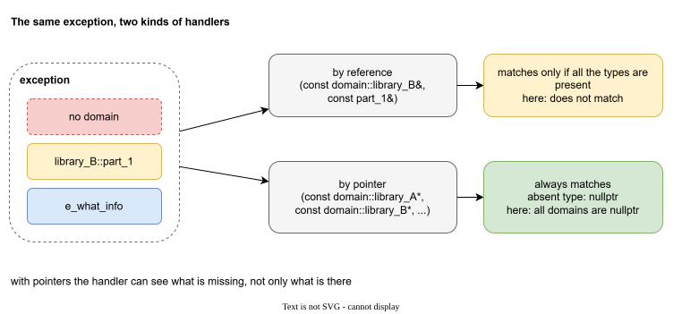

# Catching any set of types

## What we want

The handlers so far listed the types that they wanted. A handler for `library_A` and `part_1` is written by someone who already knows that such an exception may come.

We would like one more kind of handler: one that catches **any** set of types, whatever is in the exception. It is for tasks like these:

- **Check the agreement.** Every exception must have a domain and a subdomain. If one of them is not there, say so. This is the problem of case 2.
- **Report everything in one format.** Print or log all the marks that arrived, whichever they are.
- **Do something specific.** For example, count errors per library, or map the marks to an exit code.

A handler that takes types by reference cannot do this. It matches only when **all** its types are there, and it cannot ask which types are missing.

## Catch by pointers

LEAF has a way: a handler may take its parameters **by pointer**.

```cpp
leaf::try_catch(
    []{ function_lib_B_part_1_miss_domain(); },
    [](
        const exception::domain::library_A* domain_a,
        const exception::domain::library_B* domain_b,
        const exception::domain::library_C* domain_c,
        const exception::subdomain::library_B::part_1* subdomain_b_1,
        const exception::e_what_info* info
    )
    {
        if (!domain_a && !domain_b && !domain_c)
        {
            std::cout << "ERROR: no domain in exception!\n";
        }
        if (subdomain_b_1)
        {
            std::cout << "subdomain: library_B::part_1\n";
        }
        if (info)
        {
            std::cout << "what: " << info->what << '\n';
        }
    }
);
```

```text
ERROR: no domain in exception!
subdomain: library_B::part_1
what: library_B, part_1
```



A pointer handler **always matches**. A type that is in the exception arrives as a valid pointer. A type that is not in the exception arrives as `nullptr`. So the handler can see what is there, and also what is missing.

This is the case 2 of the previous page: the forgotten domain is now a message.

## What is still awkward

The pointer handler solves the problem, but writing it everywhere is not comfortable:

- It matches everything, so it must come **last**, after the handlers of the types that you do know.
- The list of pointers is long, and every place that needs it has to repeat it.
- It is a handler like any other. Whether the exception then stays here or goes up is something that every place decides on its own.

We would like the list to live in one place, to be checked by the compiler, and the decision "swallow or pass up" to be explicit. That is what the next page is about: [leaf_spy](solution.md).
