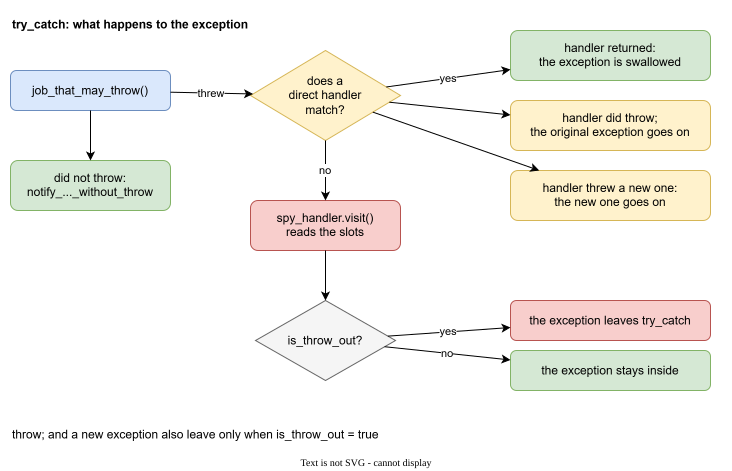

# Direct handlers

Besides the spy, `try_catch` accepts any number of direct handlers. They are the handlers of `leaf::try_catch`, with the same rules as in [A typical project](project.md).

```cpp
try_catch(
    args,
    spy,
    [](const exception::domain::library_C&, const exception::subdomain::library_C::part_2&)
    {
        std::cout << "handled in library_C, part_2\n";
    }
);
```

A handler matches when the exception has **all** the types the handler asks for.

## What happens to the exception



| situation | spy | what leaves `try_catch` |
| --- | --- | --- |
| no handler matches | runs | the original exception |
| a handler matches and returns | does not run | nothing |
| a handler matches and does `throw;` | does not run | the original exception, with all its marks |
| a handler matches and throws a new exception | does not run | the new exception |

Two details matter.

### `is_throw_out`

Everything in the last column leaves `try_catch` only when `args.is_throw_out` is `true`. With `false` the exception stays inside, even after `throw;` or a new throw. The spy still runs in the first row.

Use `true` in the middle layers, where you want the next layer up to see the exception, and `false` at the top, where the exception ends.

### `throw;` against a new exception

`throw;` is the normal way to say "I looked, but it is not for me". The original exception goes up, and the marks go with it. The next `try_catch` up sees the same marks.

Throwing something else, for example `std::runtime_error`, replaces the exception. The marks of the original are not passed on.

The two cases are told apart by the address of the exception object. If the handler rethrows the very object that was caught, it is the original.

## A handler that does not match

A handler that asks for a mark the exception does not have is skipped. The common mistake is a wrong subdomain:

```cpp
// the exception has part_3, the handler asks for part_2
[](const exception::domain::library_C&, const exception::subdomain::library_C::part_2&)
{
}
```

The exception goes to the spy and up. It is the same as [case 5](project.md#case-5-a-handler-does-not-match) of the typical project, with the spy added.
