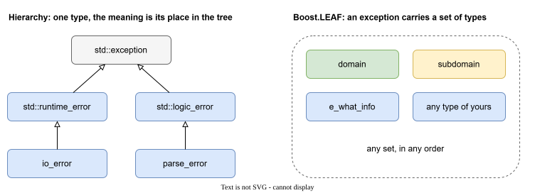

# Exceptions in a large C++ project

## The problem

In C++ an exception is a type. What it means is decided by its place in a class hierarchy: `std::runtime_error` is a runtime error, `io_error` is an input-output error, and so on.



This answers the question "what kind of error is it?". In a large program there is a second question that matters just as much: "**where does it come from?**" Which library, which part of it.

A hierarchy handles that badly:

- To tell libraries apart you need a tree of classes per library.
- An exception class is fixed. The text and the fields that it can carry are decided once, for everyone.

## Boost.LEAF

[Boost.LEAF](https://www.boost.org/doc/libs/release/libs/leaf/doc/html/index.html) is a library from the Boost collection that approaches this differently: an exception does not have to be a tree of classes. It can carry **any set of types**, and every type is just a piece of information.

The rest of this documentation uses LEAF the same way.

## Boost.LEAF in three ideas

**1. A throw puts a set of types into the exception.**

```cpp
leaf::throw_exception(library_A{}, part_1{}, e_what_info{ "library_A, part_1" });
```

`library_A{}`, `part_1{}` and `e_what_info{...}` are independent types. The exception now holds all three.

**2. A handler asks for the types it needs.**

```cpp
leaf::try_catch(
    []{ /* code that may throw */ },
    [](const library_A&, const part_1&)
    {
        // runs only if the exception has both types
    }
);
```

A handler matches when every type it asks for is in the exception. The other types do not get in its way. If no handler matches, the exception goes on.

**3. Types can be added on the way up.**

```cpp
auto load = leaf::on_error(library_B{}, part_2{});
```

While `load` is alive, every exception that passes through the scope gets two more types. Keep the object in a variable. If you drop it, the types are added and removed at once.

That is enough to continue. The next page takes an ordinary project and uses these three ideas on it: [A typical project](project.md).
