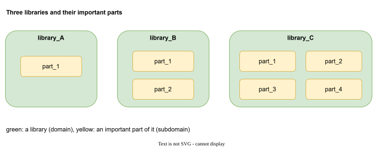
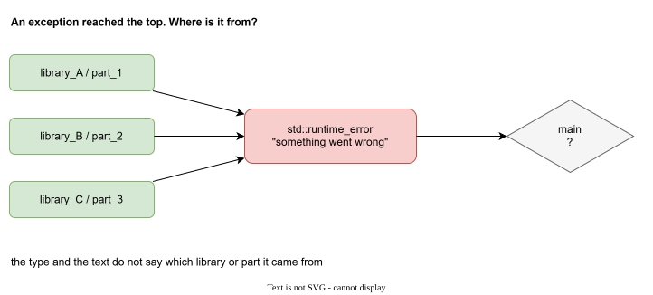
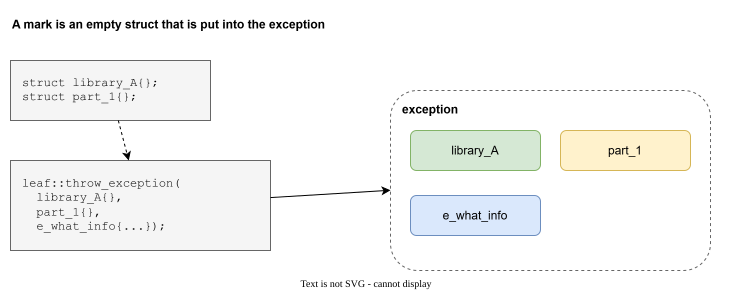
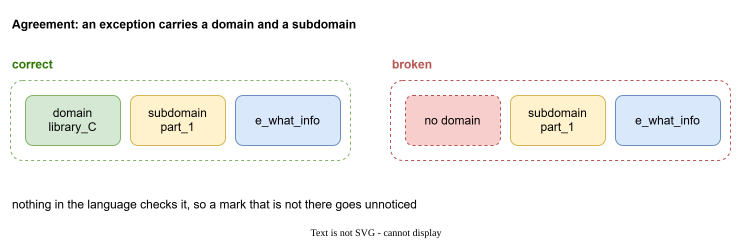
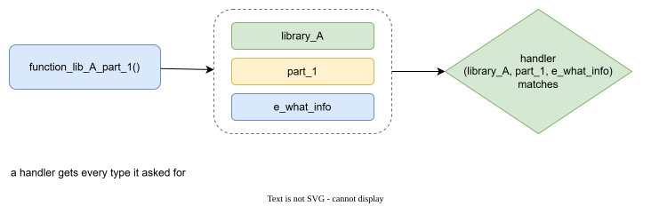
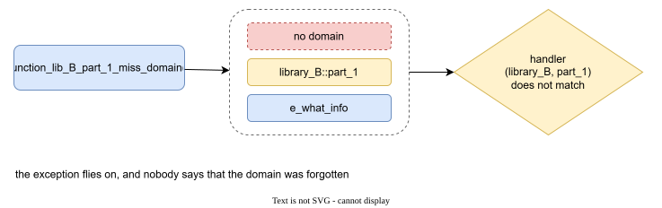
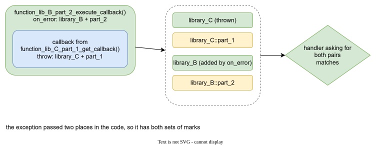
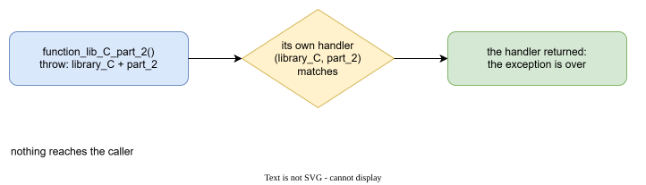
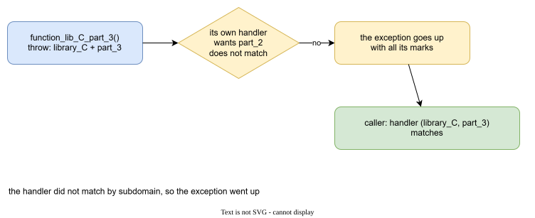
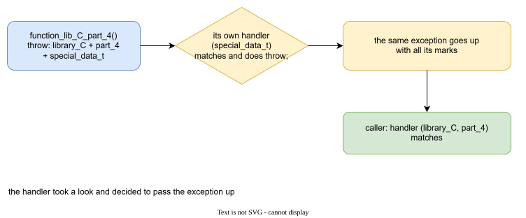

# A typical project

## Libraries and their parts

Imagine an ordinary C++ project. It is built from libraries. Every library has a few parts that matter: a module, a layer, a component.



Here there are three libraries, `library_A`, `library_B`, `library_C`, with one to four parts each.

## Where does the exception come from?

Code of one library calls code of another. When something fails deep inside, an exception travels up through all of them and arrives at the top.



By then the type and the text rarely say where it started. We want to know: **which library, which part**.

## Domains, subdomains and marks

The answer is to let every throw say where it is from. Two names help to talk about it:

- a **domain** is the library the code belongs to
- a **subdomain** is the part of that library

and the information itself is a **mark**: an empty struct that you put into the exception. It carries no data. Its type is the information.



!!! note
    Nothing is invented here. A mark is an ordinary Boost.LEAF type that is put into an exception, exactly as in the first of the [three ideas](index.md#boostleaf-in-three-ideas). "Domain" and "subdomain" are only names for two groups of such types that turn out to be useful for a project made of libraries.

### Declare the marks in one header

Keep every mark in one header, so that the throwing code and the catching code agree:

```cpp
namespace exception
{

namespace domain
{
struct library_A{};
struct library_B{};
struct library_C{};
}// namespace domain

namespace subdomain
{
namespace library_A { struct part_1{}; }
namespace library_B { struct part_1{}; struct part_2{}; }
namespace library_C { struct part_1{}; struct part_2{}; struct part_3{}; struct part_4{}; }
}// namespace subdomain

namespace details
{
struct special_data_t{};
}// namespace details

struct e_what_info
{
    std::string what;
};

}// namespace exception
```

| group | meaning |
| --- | --- |
| `domain` | the library |
| `subdomain` | a part of a library |
| `details` | clarifying details, anything you need |
| `e_*` structs | payloads with data, such as a text or a path |

### The agreement

We add one rule:

> An exception must contain a domain and a subdomain.



It is only an agreement. Nothing in C++ or LEAF checks it. Keep it in mind, because the next cases show where it gets lost.

## Six situations

All six use only Boost.LEAF. The functions are code of the three libraries. The top of the program calls them under `leaf::try_catch`.

### Case 1: a plain throw

A function of `library_A` throws with its domain, its subdomain and a text:

```cpp
void function_lib_A_part_1()
{
    leaf::throw_exception(
        exception::domain::library_A{},
        exception::subdomain::library_A::part_1{},
        exception::e_what_info{ "library_A, part_1" }
    );
}
```

The caller handles it with a handler that asks for those types:

```cpp
leaf::try_catch(
    []{ function_lib_A_part_1(); },
    [](
        const exception::domain::library_A&,
        const exception::subdomain::library_A::part_1&,
        const exception::e_what_info& info
    )
    {
        std::cout << "caught in library_A, part_1: " << info.what << '\n';
    }
);
```



```text
caught in library_A, part_1: library_A, part_1
```

### Case 2: a domain is forgotten

A function of `library_B` forgets the domain:

```cpp
void function_lib_B_part_1_miss_domain()
{
    leaf::throw_exception(
        exception::subdomain::library_B::part_1{},
        exception::e_what_info{ "library_B, part_1" }
    );
}
```

A handler that asks for the domain and the subdomain of `library_B` does not match:

```cpp
try
{
    leaf::try_catch(
        []{ function_lib_B_part_1_miss_domain(); },
        [](const exception::domain::library_B&, const exception::subdomain::library_B::part_1&)
        {
            std::cout << "caught in library_B, part_1\n";
        }
    );
}
catch (const std::exception&)
{
    std::cout << "nobody handled it, and nobody said why\n";
}
```



```text
nobody handled it, and nobody said why
```

The agreement is broken, and no one noticed. The exception just flew past every handler. This is the first thing that we will want to fix.

### Case 3: an exception gets the marks of a second domain

A function of `library_B` calls a callback that comes from `library_C`. It adds its own marks with `leaf::on_error`:

```cpp
void function_lib_B_part_2_execute_callback(std::function<void()> callback)
{
    // attach the domain and subdomain of the place that called the callback
    auto load = leaf::on_error(
        exception::domain::library_B{},
        exception::subdomain::library_B::part_2{}
    );

    callback();
}
```

The callback comes from `library_C` and throws with its own marks:

```cpp
std::function<void()> function_lib_C_part_1_get_callback()
{
    return []
    {
        leaf::throw_exception(
            exception::domain::library_C{},
            exception::subdomain::library_C::part_1{},
            exception::e_what_info{ "callback from library_C, part_1" }
        );
    };
}
```

The exception passes through two places, and carries the marks of both:

```cpp
leaf::try_catch(
    []
    {
        function_lib_B_part_2_execute_callback(function_lib_C_part_1_get_callback());
    },
    [](
        const exception::domain::library_B&,
        const exception::subdomain::library_B::part_2&,
        const exception::domain::library_C&,
        const exception::subdomain::library_C::part_1&
    )
    {
        std::cout << "caught: library_C, part_1 called from library_B, part_2\n";
    }
);
```



```text
caught: library_C, part_1 called from library_B, part_2
```

So the exception tells not only where it started, but also who called.

### Case 4: a library handles its own exception

A function of `library_C` catches its own exception inside:

```cpp
void function_lib_C_part_2()
{
    leaf::try_catch(
        []
        {
            leaf::throw_exception(
                exception::domain::library_C{},
                exception::subdomain::library_C::part_2{},
                exception::e_what_info{ "library_C, part_2" }
            );
        },
        [](const exception::domain::library_C&, const exception::subdomain::library_C::part_2&)
        {
            std::cout << "handled inside library_C, part_2\n";
        }
    );
}
```



```text
handled inside library_C, part_2
```

The handler returned, and the exception is over. Nothing reaches the caller.

### Case 5: a handler does not match

The same shape, but the handler asks for `part_2` while the exception has `part_3`:

```cpp
void function_lib_C_part_3()
{
    leaf::try_catch(
        []
        {
            leaf::throw_exception(
                exception::domain::library_C{},
                exception::subdomain::library_C::part_3{},
                exception::e_what_info{ "library_C, part_3" }
            );
        },
        // asks for part_2, but the exception has part_3
        [](const exception::domain::library_C&, const exception::subdomain::library_C::part_2&)
        {
            std::cout << "handled inside library_C, part_3\n";
        }
    );
}
```

The handler does not match, so the exception goes up with all its marks. The caller handles it:

```cpp
leaf::try_catch(
    []{ function_lib_C_part_3(); },
    [](const exception::domain::library_C&, const exception::subdomain::library_C::part_3&)
    {
        std::cout << "main: caught library_C, part_3\n";
    }
);
```



```text
main: caught library_C, part_3
```

### Case 6: a handler looks and passes it up

A handler matches, does something, and rethrows with `throw;`:

```cpp
void function_lib_C_part_4()
{
    leaf::try_catch(
        []
        {
            leaf::throw_exception(
                exception::domain::library_C{},
                exception::subdomain::library_C::part_4{},
                exception::details::special_data_t{},
                exception::e_what_info{ "library_C, part_4" }
            );
        },
        [](const exception::details::special_data_t&)
        {
            std::cout << "inner handler: special data, pass it up\n";
            throw;
        }
    );
}
```

The caller still sees all the marks:

```cpp
leaf::try_catch(
    []{ function_lib_C_part_4(); },
    [](const exception::domain::library_C&, const exception::subdomain::library_C::part_4&)
    {
        std::cout << "main: caught library_C, part_4\n";
    }
);
```



```text
inner handler: special data, pass it up
main: caught library_C, part_4
```

## What we have, and what is missing

With Boost.LEAF alone we can mark the exceptions of a project, add marks on the way up, handle by marks, and pass an exception on.

Case 2 showed what is missing: nobody noticed that a mark was not there. The next page is about that: [Catching any set of types](any-set.md).
