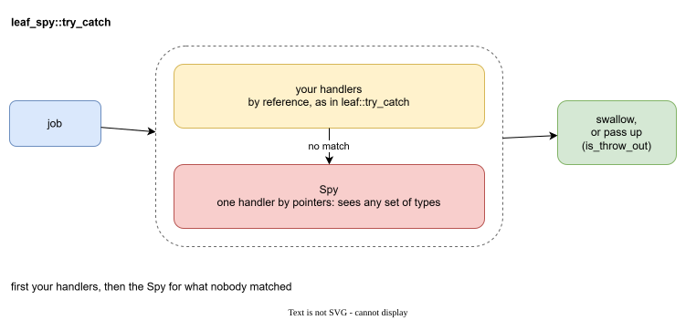

# leaf_spy

`leaf_spy` is the solution to what the previous pages wanted. It is a small header-only wrapper around Boost.LEAF. It gives you one function, `try_catch`.

`try_catch` is `leaf::try_catch` plus one more handler, the **Spy**:

1. First your handlers try, by reference, exactly as in `leaf::try_catch`.
2. If none of them matched, the **Spy** gets the exception. The Spy is the catch-all handler by pointers from the previous page, moved into one reusable object. It sees any set of types.
3. A flag, `is_throw_out`, says whether the exception stays inside `try_catch` or goes up.

## What you get

- **The list of marks lives in one place.** The Spy is a small struct. Its `operator()` lists the marks, and the compiler checks that every one is a pointer.
- **A catch-all that is always last.** You do not have to order handlers by hand. The Spy runs only when no other handler matched.
- **A clear decision what leaves.** A handler can swallow the exception, pass the original up with `throw;`, or throw a new one. `is_throw_out` turns all of these on or off at once.
- **Threads.** `captured_leaf_exception` carries the marks from a worker thread to the thread that catches.

## Where to read next

| If you want to... | Read |
| --- | --- |
| build it and run the first program | [Getting started](getting-started.md) |
| print or log the marks of any exception | [The spy handler](spy.md) |
| catch some exceptions yourself | [Direct handlers](handlers.md) |
| use it with threads | [Threads](threads.md) |
| use it in unit tests | [Testing](testing.md) |
| look up an exact signature | [Reference](reference.md) |
