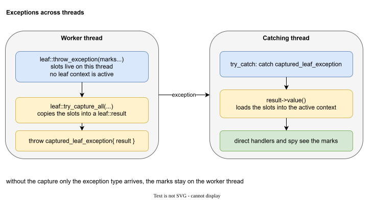

# Threads

Boost.LEAF keeps the marks of an exception in the thread that threw it. When the exception is rethrown on another thread, only the exception object arrives. The marks stay behind.

This matters when a job runs on a worker thread, for example in a task graph, and the result is rethrown on the thread that waits for it. If no leaf context is active on the worker, the marks are lost.



## On the worker thread

Capture the marks, and throw `captured_leaf_exception` that holds the capture:

```cpp
[[noreturn]] void fail(std::string what)
{
    auto captured = leaf::try_capture_all([&]
    {
        leaf::throw_exception(
            exception::domain::library_A{},
            exception::subdomain::library_A::part_1{},
            exception::e_what_info{ std::move(what) }
        );
    });
    throw ::leaf_spy::captured_leaf_exception{ std::move(captured) };
}
```

`try_capture_all` runs the lambda, catches whatever it throws, and returns a `leaf::result<void>` with all the marks copied inside.

## On the catching thread

Nothing to do. `try_catch` catches `captured_leaf_exception`, calls `result->value()` and the marks are loaded into its context. Direct handlers and the spy then see them as if the exception had been thrown here.

## Details

- `captured_leaf_exception` is `std::exception`-derived, so it travels through the usual machinery (`std::exception_ptr`, futures).
- The `result` is held by a `std::shared_ptr`, so copying the exception is cheap.
- If the job itself runs on the catching thread, none of this is needed.
